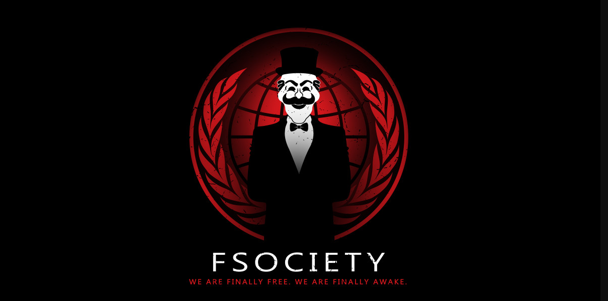

<div align="center">
  
</div>

# FSOCIETY Full-Screen Break Blocker

Aplikasi desktop berbasis Python (`tkinter`) yang dirancang untuk mengunci layar penuh (*fullscreen*) selama **1 jam** sebagai pengingat waktu istirahat sejenak. Saat dijalankan, aplikasi menampilkan gambar utama, teks berwarna merah dengan animasi efek mengetik, hitung mundur waktu, serta memblokir sementara input mouse dan keyboard hingga timer selesai.

### ✨ Fitur Utama

- **Tampilan Layar Penuh Tanpa Bingkai:** Menggunakan mode `-fullscreen`, `-topmost`, dan `overrideredirect(True)` dengan latar belakang hitam pekat sehingga jendela selalu berada di lapisan paling atas.
- **Animasi Efek Mengetik (*Typewriter Effect*):** Menampilkan pesan pengingat berwarna merah karakter demi karakter (*"Istirahatlah selama 1 jam. Setelah itu, kembalilah berjuang untuk masa depanmu."*) sebelum hitungan mundur dimulai.
- **Hitung Mundur Otomatis (1 jam):** Menampilkan timer berformat `JJ:MM:DD` dan menutup program secara otomatis saat waktu habis.
- **Pemblokiran Input Sementara:** Mencegah interaksi klik mouse dan tombol keyboard standar serta mengembalikan fokus jendela secara otomatis jika pengguna mencoba berpindah aplikasi.
- **Dukungan Kompilasi `.exe`:** Dilengkapi fungsi `resource_path` agar aset gambar (`image.png`) dan ikon (`icone.ico`) tetap terbaca saat dibungkus menggunakan PyInstaller.

### ⚠️ Peringatan Penting

**Gunakan dengan bijak!** Proyek ini dibuat semata-mata untuk tujuan edukasi, eksperimen antarmuka Python, dan pengingat istirahat pribadi. Dilarang menyalahgunakan skrip ini untuk mengerjai, mengganggu, atau merugikan perangkat orang lain tanpa izin.

## 📄 Lisensi

Proyek ini dilisensikan di bawah **MIT License** — lihat file [LICENSE](LICENSE) untuk detail selengkapnya.

Anda bebas menggunakan, memodifikasi, dan mendistribusikan ulang kode ini untuk tujuan pembelajaran maupun pengembangan pribadi dengan tetap menyertakan pemberitahuan hak cipta asli, serta dengan ketentuan bahwa penulis tidak bertanggung jawab atas segala bentuk penyalahgunaan program ini.

Hal yang perlu diperhatikan sebelum menjalankan perintah program:
1. **Layar & Input Akan Terkunci:** Begitu skrip dijalankan, layar Anda akan langsung tertutup penuh dan seluruh klik mouse maupun tombol keyboard standar tidak akan berfungsi selama timer berjalan. Pastikan semua pekerjaan penting sudah disimpan terlebih dahulu.
2. **Cara Menghentikan Paksa (Tombol Darurat):** Jika Anda ingin keluar sebelum hitung mundur selesai, tekan kombinasi tombol:
   ```text
   Shift + Esc

### 📋 Struktur Proyek

```text
FSOCIETY/
├── icone.ico     # Ikon aplikasi (untuk build executable)
├── image.png     # Gambar utama yang ditampilkan di tengah layar
├── README.md     # Dokumentasi repositori
└── script.py     # Kode sumber utama aplikasi